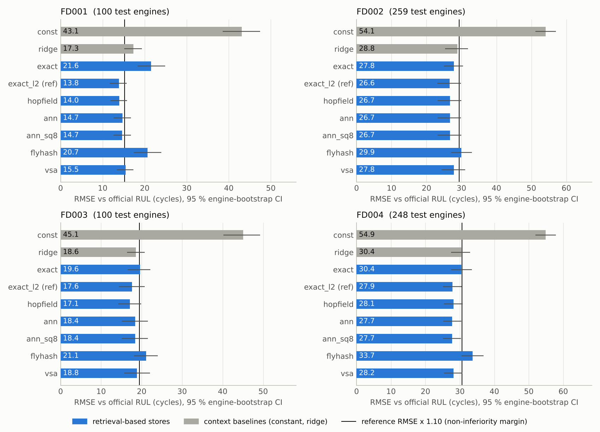
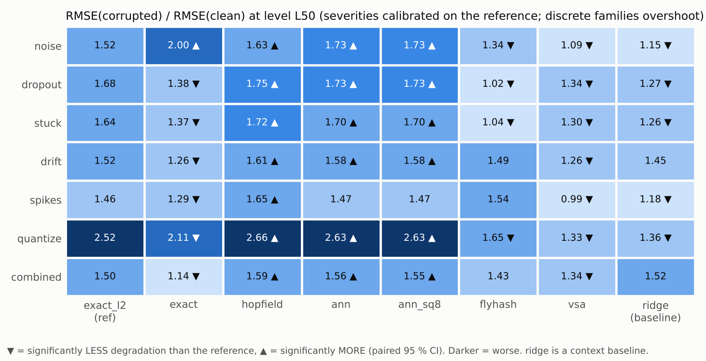
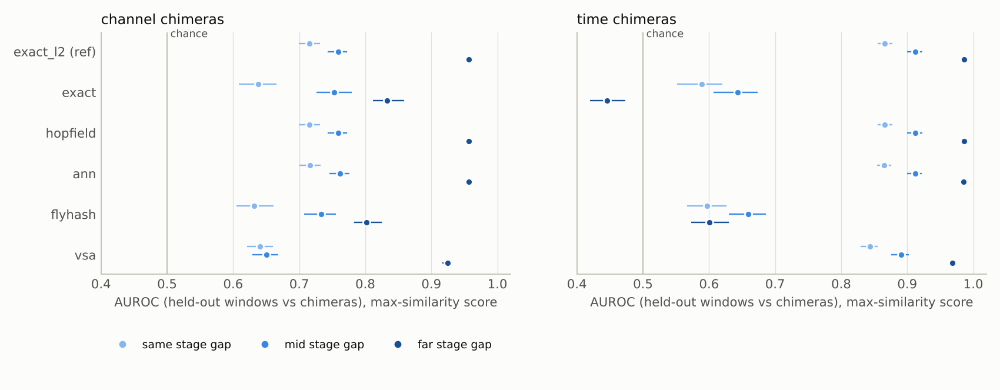
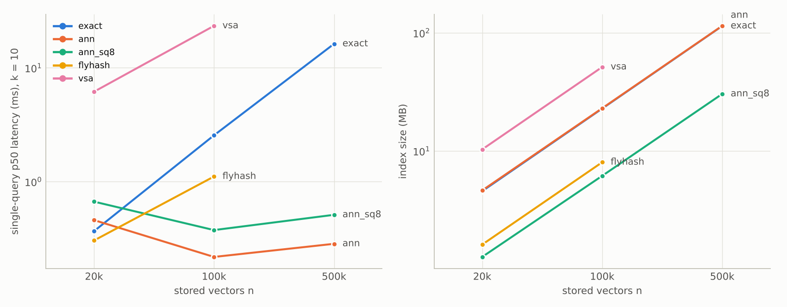

# PdM study on NASA C-MAPSS: NeuroStore-style memories for remaining-useful-life estimation

_Generated by `studies/pdm_cmapss/make_report.py` from `results/pdm_cmapss/*.json` (result commit 1cc74c3, protocol sha256 `1e951b7940fc`). Do not edit by hand._

## Summary

`nsharness` is the Colab benchmark turned into a domain-neutral harness: one featurizer, five interchangeable stores (exact, IVF with optional 8-bit vectors, FlyHash, Hopfield, VSA), seven standardized corruption families, OOD and chimera tests, and latency, throughput and deployed-bytes accounting. Its first domain is predictive maintenance on NASA C-MAPSS. The protocol and the gate rows below were committed before any real-data result existed; 9 of 15 gate rows came out HELD, and the rest are reported as they are.

**What C-MAPSS can and cannot say.** It is a simulation. Its sensor noise is simulated and every corruption in the sweeps was injected by the harness, so nothing here measures natural field corruption (dead sensors, real drift, gaps). That needs real data; NASA's IMS bearing run-to-failure set is the obvious next one. Everything below ran on one CPU thread with NumPy; no accelerator was measured.

**Findings**

1. **Retrieval is a competent RUL estimator (G2 HELD).** On the FD001 official test the exact Euclidean store has RMSE 13.8 cycles (95 % CI 11.7-15.7), against 43.1 for a constant predictor and 17.3 for ridge regression on the same features. It stays ahead of ridge and the constant on FD002 to FD004 (reference RMSE 26.6, 17.6, 27.9), though on FD003 its edge over ridge is inside the noise (ratio 0.95, CI 0.79-1.09).
2. **The similarity function mattered more than the storage format.** Cosine exact is 1.56 times worse than Euclidean exact on the official test (RMSE 21.6 against 13.8; cross-validated 19.84 against 14.48) because cosine discards magnitude on z-scored statistics features. I only noticed because a smoke test on fake data showed "VSA beats exact". The study therefore carries both and takes the better one as the reference (P6 CONFIRMED), so that the comparisons below are about the architecture and not about the metric.
3. **What keeps up with exact (G3, margin 10 %).** Hopfield attention with the same similarity has ratio 1.011 (HELD): it is the exact store with a softmax kernel, same accuracy and same bytes. IVF has ratio 1.062 and IVF with 8-bit vectors 1.060 (verdicts INCONCLUSIVE and INCONCLUSIVE: the point estimates sit inside the margin and the upper confidence bounds just outside it). VSA has ratio 1.117 (NOT HELD: it misses the margin on FD001 by a hair, and is within a few percent of the reference on FD002 to FD004). FlyHash has ratio 1.493 (NOT HELD); it was behind the reference on every sub-dataset, and its best cross-validated configuration was the smallest and sparsest code in the grid.
4. **Cost (G4 HELD).** Deployed bytes as a multiple of the exact store's: IVF with 8-bit vectors 0.31, FlyHash 0.36, VSA 2.23. P1 (outcome REFUTED) guessed that neither sparse code would be smaller than the exact store, since an item is only 56 floats; that held for VSA, but FlyHash is small because cross-validation picked the sparsest code in its grid, and that code is also the one with the largest loss against exact. The memory half of G4 is met by IVF with 8-bit vectors, whose G3 verdict is INCONCLUSIVE, which the pre-registered G4 rule accepts. For one query at 20 thousand items IVF is not faster than brute force (p50 0.90 ms against 0.56 ms); at 500,000 clustered synthetic vectors it is 57 times faster at recall@10 0.99 (those clusters are easy, real data may need more probes).
5. **Robustness (G5 HELD).** At the middle severity level (L50, calibrated on the reference, see the table of severities), VSA degrades significantly less than the reference in 7 of 7 families, and its absolute RMSE under corruption is lower in 7 of 7 even though its clean RMSE is worse. FlyHash degrades less in 4 families, but from a worse starting point, so read the ratio table next to the absolute table. Hopfield and IVF degrade more than the reference (worse in 7 and 6 families); one plausible cause for IVF is that a corrupted query is assigned to the wrong cells, which I have not tested. Why VSA is robust is also untested here.
6. **The store has to be told which sensors are dead (G7 HELD).** With the observed-sensor mask, the reference's degradation under 3 lost channels falls from 1.68 to 1.02 times, and completion NMSE with 30 % of channels lost falls from 1.417 (worse than mean imputation, 0.949) to 0.297. Without the mask the zero-filled channels mislead retrieval, so an unflagged retrieval store can be worse than no memory at all. VSA is the least affected without the mask (0.770).
7. **Familiarity (G6a NOT HELD, G6b HELD, G6c HELD).** Gaussian windows are flagged perfectly. Channel chimeras are detected better as the life-stage gap grows (AUROC 0.715, 0.759, 0.957 for same, mid, far), but the same-stage control is well above chance (P5 CONFIRMED) and time-splice chimeras are detectable even at the same stage (0.866), so part of the signal is a splicing artefact and not physics. A new fault mode at the same operating condition (FD003 late-life windows against an FD001 memory) is only weakly recognised (0.701, CI 0.642-0.755), whereas new operating conditions (FD002) are trivial (0.996). Cosine familiarity is blind to some chimeras: its far-gap time-splice AUROC is 0.446, below chance. Hopfield's neg-energy score adds nothing over plain max similarity here (far-gap channel chimeras 0.954 against 0.957).

**What I would not conclude.** That FlyHash is poor in general (it was tried on 56 dense float features with a nine-point grid whose best point was an edge). That VSA beats exact (its clean accuracy is worse; the robustness edge is for injected corruption and its mechanism is untested). That the ANN speed-up carries over to real feature distributions. That any of this transfers to real sensors. Several selected readouts sit at the edge of the pre-registered grid (k at its largest value for every store, see the flags below), so all ratios are relative to a reference that could be tuned a little further.


## Gate verdicts (pre-registered, `gates.toml`)

| gate | verdict | claim | evidence |
|---|---|---|---|
| G0 | **HELD** | every result file comes from committed code, the committed protocol and the pinned data | all files from commit 1cc74c3 |
| G1 | **HELD** | the harness reproduces the closed-form flat-search recall on the synthetic +-1 world | 5/5 configurations inside the interval |
| G2 | **HELD** | exact retrieval beats a constant predictor clearly and stays within 25 % of ridge regression | RMSE 13.8 (exact_l2) vs const 43.1 (ratio 0.32) and ridge 17.3 (ratio 0.80) |
| G3[hopfield] | **HELD** | the alternative store loses at most 10 % RMSE against exact | RMSE 14.0; ratio vs exact_l2 1.011 (0.975-1.047) |
| G3[ann] | **INCONCLUSIVE** | the alternative store loses at most 10 % RMSE against exact | RMSE 14.7; ratio vs exact_l2 1.062 (1.014-1.115) |
| G3[ann_sq8] | **INCONCLUSIVE** | the alternative store loses at most 10 % RMSE against exact | RMSE 14.7; ratio vs exact_l2 1.060 (1.012-1.113) |
| G3[flyhash] | **NOT HELD** | the alternative store loses at most 10 % RMSE against exact | RMSE 20.7; ratio vs exact_l2 1.493 (1.275-1.769) |
| G3[vsa] | **NOT HELD** | the alternative store loses at most 10 % RMSE against exact | RMSE 15.5; ratio vs exact_l2 1.117 (1.042-1.195) |
| G3[exact] | **NOT HELD** | the alternative store loses at most 10 % RMSE against exact | RMSE 21.6; ratio vs exact_l2 1.557 (1.331-1.862) |
| G4 | **HELD** | some store that is non-inferior needs <= 50 % of exact's deployed bytes, and ANN is >= 3x faster than exact at n = 500k with recall@10 >= 0.9 | deployed bytes / exact_l2: hopfield 1.00x, ann 1.03x, ann_sq8 0.31x, flyhash 0.36x, vsa 2.23x. Memory part ok: ['ann_sq8']. Latency at scale: ann: 0.017 of exact p50, recall@10 0.99, nprobe 1, ann_sq8: 0.031 of exact p50, recall@10 0.95, nprobe 1 |
| G5 | **HELD** | some alternative backend degrades less than exact in at least 3 of 7 corruption families (paired CI excludes zero) | hopfield: better in 0, worse in 7; ann: better in 0, worse in 6; ann_sq8: better in 0, worse in 6; flyhash: better in 4 (noise, dropout, stuck, quantize), worse in 0; vsa: better in 7 (noise, dropout, stuck, drift, spikes, quantize, combined), worse in 0 |
| G6a | **NOT HELD** | the memory recognises late-life windows of a different fault mode as unfamiliar | AUROC 0.701 (0.642-0.755) |
| G6b | **HELD** | channel chimeras assembled from far-apart life stages are detected much better than same-stage chimeras | far 0.957 (0.951-0.963), mid 0.759, same 0.715 (0.699-0.732) |
| G6c | **HELD** | Gaussian-noise windows are flagged as unfamiliar | AUROC 1.000 (1.000-1.000) |
| G7 | **HELD** | with 30 % of channels lost, the mask-aware exact store restores the missing features far better than mean imputation | exact_l2_mask NMSE 0.297 (0.284-0.314) with 5 of 14 channels lost; mean imputation 0.949 |

## Predictions recorded before the run

| id | prediction (recorded before the run) | outcome | evidence |
|---|---|---|---|
| P1 | FlyHash and VSA need at least as many deployed bytes as the exact store | **REFUTED** | flyhash 0.36x, vsa 2.23x of exact_l2 |
| P2 | SQ8 costs <= 2 % RMSE relative to fp32 IVF (official test) | **CONFIRMED** | ann_sq8 / ann - 1 = -0.24 % |
| P3 | Hopfield is within +-3 % RMSE of the reference | **CONFIRMED** | ratio 1.011 |
| P4 | Knowing which sensors are dead lowers completion NMSE for exact, exact_l2, hopfield at all severities (scored with non-overlapping unpaired CIs, see deviations) | **CONFIRMED** | exact@0.1: 0.466 vs 1.048; exact@0.3: 0.435 vs 2.599; exact@0.5: 0.431 vs 3.512; exact_l2@0.1: 0.287 vs 0.678; exact_l2@0.3: 0.297 vs 1.417; exact_l2@0.5: 0.306 vs 2.566; hopfield@0.1: 0.297 vs 0.747; hopfield@0.3: 0.315 vs 1.675; hopfield@0.5: 0.319 vs 2.835 |
| P5 | Same-stage chimera control has AUROC > 0.55 | **CONFIRMED** | AUROC 0.715 (0.699-0.732) |
| P6 | Euclidean exact beats cosine exact in CV (reference = exact_l2) | **CONFIRMED** | CV RMSE exact 19.843, exact_l2 14.483 |

## E6 Harness validity

Exact search on random +-1 patterns against the closed-form tie-aware recall (4000 queries x 3 seeds per row):

| D | N | p_flip | observed | 99.7 % interval | closed form | inside |
|---:|---:|---:|---:|---:|---:|---:|
| 256 | 512 | 0.35 | 0.958 | 0.952-0.963 | 0.956 | yes |
| 256 | 512 | 0.4 | 0.557 | 0.543-0.570 | 0.565 | yes |
| 512 | 512 | 0.4 | 0.923 | 0.915-0.930 | 0.921 | yes |
| 1024 | 1024 | 0.44 | 0.710 | 0.698-0.722 | 0.715 | yes |
| 128 | 256 | 0.3 | 0.956 | 0.950-0.961 | 0.954 | yes |

The Colab benchmark's noisy-pattern recall (top-1, D=512, N=2048, 2000 queries, default-ish configurations: ann nprobe 8, flyhash m=4096 / 5 % active, vsa D=4096):

| bit-flip p | exact | hopfield | ann | flyhash | vsa |
|---|---|---|---|---|---|
| 0.1 | 1.000 | 1.000 | 0.999 | 1.000 | 1.000 |
| 0.2 | 1.000 | 1.000 | 0.972 | 1.000 | 1.000 |
| 0.3 | 1.000 | 1.000 | 0.794 | 0.981 | 0.987 |
| 0.35 | 0.998 | 0.998 | 0.614 | 0.738 | 0.760 |
| 0.4 | 0.861 | 0.861 | 0.392 | 0.239 | 0.257 |

## E0 Tuning on training engines (engine-grouped CV)

**FD001** (100 engines, 20631 windows, 1000 CV queries). Reference = **exact_l2**; const CV RMSE 43.92, ridge 17.76 (lambda 100.0).

| variant | CV RMSE | selected | rule | flags |
|---|---|---|---|---|
| exact | 19.843 | k=20, beta=10.0 | min_cv_rmse |  |
| exact_l2 | 14.483 | k=50, beta=10.0 | min_cv_rmse | k at grid edge |
| hopfield | 14.448 | metric=l2, k=1, beta=30.0 | min_cv_rmse |  |
| ann | 14.245 | nprobe=4, sq8=False, metric=l2, k=50, beta=None | smallest_nprobe_within_1.02x_of_exact | k at grid edge, beta at grid edge |
| ann_sq8 | 14.257 | nprobe=4, sq8=True, metric=l2, k=50, beta=None | smallest_nprobe_within_1.02x_of_exact | k at grid edge, beta at grid edge |
| flyhash | 19.626 | m=1024, frac=0.02, k=50, beta=10.0 | min_cv_rmse | k at grid edge |
| vsa | 15.903 | D=4096, k=50, beta=100.0 | min_cv_rmse | k at grid edge |

**FD002** (260 engines, 53759 windows, 2600 CV queries). Reference = **exact_l2**; const CV RMSE 42.46, ridge 18.53 (lambda 1000.0).

| variant | CV RMSE | selected | rule | flags |
|---|---|---|---|---|
| exact | 20.555 | k=20, beta=10.0 | min_cv_rmse |  |
| exact_l2 | 16.871 | k=50, beta=3.0 | min_cv_rmse | k at grid edge |
| hopfield | 17.086 | metric=l2, k=1, beta=30.0 | min_cv_rmse |  |
| ann | 16.923 | nprobe=4, sq8=False, metric=l2, k=50, beta=3.0 | min_cv_rmse | k at grid edge |
| ann_sq8 | 16.930 | nprobe=4, sq8=True, metric=l2, k=50, beta=3.0 | min_cv_rmse | k at grid edge |
| flyhash | 21.921 | m=1024, frac=0.02, k=50, beta=10.0 | min_cv_rmse | k at grid edge |
| vsa | 17.932 | D=4096, k=50, beta=100.0 | min_cv_rmse | k at grid edge |

**FD003** (100 engines, 24720 windows, 1000 CV queries). Reference = **exact_l2**; const CV RMSE 45.13, ridge 17.24 (lambda 100.0).

| variant | CV RMSE | selected | rule | flags |
|---|---|---|---|---|
| exact | 16.896 | k=50, beta=None | min_cv_rmse | k at grid edge, beta at grid edge |
| exact_l2 | 13.536 | k=50, beta=None | min_cv_rmse | k at grid edge, beta at grid edge |
| hopfield | 13.620 | metric=l2, k=1, beta=30.0 | min_cv_rmse |  |
| ann | 13.585 | nprobe=4, sq8=False, metric=l2, k=50, beta=None | min_cv_rmse | k at grid edge, beta at grid edge |
| ann_sq8 | 13.587 | nprobe=4, sq8=True, metric=l2, k=50, beta=None | min_cv_rmse | k at grid edge, beta at grid edge |
| flyhash | 18.576 | m=1024, frac=0.02, k=50, beta=10.0 | min_cv_rmse | k at grid edge |
| vsa | 14.750 | D=4096, k=50, beta=100.0 | min_cv_rmse | k at grid edge |

**FD004** (249 engines, 61249 windows, 2490 CV queries). Reference = **exact_l2**; const CV RMSE 43.04, ridge 19.80 (lambda 0.01).

| variant | CV RMSE | selected | rule | flags |
|---|---|---|---|---|
| exact | 19.956 | k=50, beta=30.0 | min_cv_rmse | k at grid edge |
| exact_l2 | 16.675 | k=50, beta=None | min_cv_rmse | k at grid edge, beta at grid edge |
| hopfield | 16.978 | metric=l2, k=1, beta=30.0 | min_cv_rmse |  |
| ann | 16.779 | nprobe=4, sq8=False, metric=l2, k=50, beta=None | min_cv_rmse | k at grid edge, beta at grid edge |
| ann_sq8 | 16.784 | nprobe=4, sq8=True, metric=l2, k=50, beta=None | min_cv_rmse | k at grid edge, beta at grid edge |
| flyhash | 22.152 | m=1024, frac=0.02, k=50, beta=10.0 | min_cv_rmse | k at grid edge |
| vsa | 18.060 | D=4096, k=50, beta=100.0 | min_cv_rmse | k at grid edge |

## E1 Official test



**FD001** (100 test engines, 100 training engines, 14 channels)

| variant | RMSE vs official RUL (CI) | RMSE vs capped | MAE | NASA score | RMSE ratio vs reference (CI) |
|---|---:|---:|---:|---:|---:|
| const | 43.1 (38.6-47.4) | 41.9 | 35.9 | 33629 | 3.111 (2.573-3.834) |
| ridge | 17.3 (15.2-19.4) | 16.1 | 14.2 | 493 | 1.248 (1.099-1.426) |
| exact | 21.6 (18.4-24.9) | 21.0 | 17.2 | 1050 | 1.557 (1.331-1.862) |
| exact_l2 (ref) | 13.8 (11.7-15.7) | 12.5 | 10.6 | 301 | - |
| hopfield | 14.0 (11.9-15.8) | 12.6 | 10.8 | 311 | 1.011 (0.975-1.047) |
| ann | 14.7 (12.7-16.7) | 13.4 | 11.1 | 364 | 1.062 (1.014-1.115) |
| ann_sq8 | 14.7 (12.6-16.7) | 13.3 | 11.1 | 363 | 1.060 (1.012-1.113) |
| flyhash | 20.7 (17.4-24.0) | 20.0 | 15.5 | 1156 | 1.493 (1.275-1.769) |
| vsa | 15.5 (13.4-17.4) | 14.1 | 11.9 | 403 | 1.117 (1.042-1.195) |

**FD002** (259 test engines, 260 training engines, 14 channels)

| variant | RMSE vs official RUL (CI) | RMSE vs capped | MAE | NASA score | RMSE ratio vs reference (CI) |
|---|---:|---:|---:|---:|---:|
| const | 54.1 (51.2-57.0) | 44.9 | 45.6 | 153229 | 2.030 (1.851-2.274) |
| ridge | 28.8 (25.3-31.9) | 16.8 | 20.4 | 11486 | 1.082 (1.044-1.126) |
| exact | 27.8 (25.0-30.5) | 17.7 | 20.6 | 5853 | 1.045 (0.996-1.110) |
| exact_l2 (ref) | 26.6 (23.1-29.9) | 13.0 | 17.4 | 8179 | - |
| hopfield | 26.7 (23.2-30.0) | 13.2 | 17.5 | 7916 | 1.003 (0.993-1.015) |
| ann | 26.7 (23.2-29.9) | 13.5 | 17.6 | 8036 | 1.003 (0.991-1.019) |
| ann_sq8 | 26.7 (23.2-29.9) | 13.5 | 17.6 | 7986 | 1.003 (0.990-1.019) |
| flyhash | 29.9 (27.0-33.0) | 20.0 | 21.8 | 12262 | 1.123 (1.063-1.199) |
| vsa | 27.8 (24.3-31.1) | 14.4 | 18.7 | 10125 | 1.043 (1.026-1.063) |

**FD003** (100 test engines, 100 training engines, 15 channels)

| variant | RMSE vs official RUL (CI) | RMSE vs capped | MAE | NASA score | RMSE ratio vs reference (CI) |
|---|---:|---:|---:|---:|---:|
| const | 45.1 (40.2-49.2) | 43.7 | 38.0 | 57950 | 2.554 (2.070-3.292) |
| ridge | 18.6 (16.4-20.7) | 16.9 | 15.6 | 572 | 1.053 (0.921-1.266) |
| exact | 19.6 (16.6-22.1) | 18.4 | 15.8 | 886 | 1.111 (0.964-1.303) |
| exact_l2 (ref) | 17.6 (14.4-20.8) | 16.4 | 12.6 | 1294 | - |
| hopfield | 17.1 (14.2-19.9) | 15.8 | 12.6 | 771 | 0.971 (0.920-1.025) |
| ann | 18.4 (15.1-21.6) | 17.2 | 13.1 | 1477 | 1.045 (1.007-1.086) |
| ann_sq8 | 18.4 (15.1-21.5) | 17.1 | 13.1 | 1469 | 1.043 (1.006-1.083) |
| flyhash | 21.1 (18.1-24.0) | 19.4 | 16.1 | 1134 | 1.196 (1.028-1.440) |
| vsa | 18.8 (15.7-22.0) | 17.6 | 13.7 | 1524 | 1.066 (1.009-1.135) |

**FD004** (248 test engines, 249 training engines, 14 channels)

| variant | RMSE vs official RUL (CI) | RMSE vs capped | MAE | NASA score | RMSE ratio vs reference (CI) |
|---|---:|---:|---:|---:|---:|
| const | 54.9 (51.9-57.9) | 45.6 | 46.8 | 189683 | 1.970 (1.816-2.174) |
| ridge | 30.4 (27.4-33.0) | 19.3 | 23.3 | 7604 | 1.089 (1.044-1.136) |
| exact | 30.4 (27.4-33.5) | 20.1 | 22.4 | 7723 | 1.092 (1.042-1.146) |
| exact_l2 (ref) | 27.9 (25.1-30.5) | 16.1 | 20.3 | 5375 | - |
| hopfield | 28.1 (25.3-30.8) | 16.5 | 20.7 | 5685 | 1.009 (0.997-1.023) |
| ann | 27.7 (25.1-30.4) | 16.3 | 20.2 | 5327 | 0.996 (0.982-1.009) |
| ann_sq8 | 27.7 (25.1-30.3) | 16.2 | 20.2 | 5259 | 0.994 (0.980-1.008) |
| flyhash | 33.7 (30.5-36.9) | 22.7 | 25.4 | 14655 | 1.210 (1.145-1.283) |
| vsa | 28.2 (25.4-30.8) | 16.9 | 20.8 | 5913 | 1.012 (0.989-1.036) |

## E2 Corruption sweeps (FD001)



Out-of-fold queries: 1000 from 100 engines. Reference = **exact_l2**. Severities were calibrated once on the reference so that each family hurts it by the stated multiple.

| family | L25 (target x1.25) | L50 (target x1.50) | L100 (target x2.00) |
|---|---|---|---|
| noise | sigma 0.42 z -> x1.28 | sigma 0.51 z -> x1.53 | sigma 0.62 z -> x2.05 |
| dropout | 2 of 14 channels lost -> x1.41 | 3 of 14 channels lost -> x1.70 | 4 of 14 channels lost -> x2.04 |
| stuck | 2 of 14 channels flatlined -> x1.37 | 3 of 14 channels flatlined -> x1.70 | 4 of 14 channels flatlined -> x2.03 |
| drift | 4 channels ramp to 0.91 z -> x1.30 | 4 channels ramp to 1.22 z -> x1.50 | 4 channels ramp to 1.89 z -> x2.02 |
| spikes | 0.50 % of samples hit by +-5 z -> x1.27 | 0.84 % of samples hit by +-5 z -> x1.52 | 1.61 % of samples hit by +-5 z -> x2.00 |
| quantize | 2-bit ADC -> x2.52 | 2-bit ADC -> x2.52 | 2-bit ADC -> x2.52 |
| combined | 2 lost + sigma 0.09 z + drift 0.36 z -> x1.31 | 3 lost + sigma 0.23 z + drift 0.90 z -> x1.51 | 4 lost + sigma 0.34 z + drift 1.38 z -> x2.04 |

<details><summary>Level L25</summary>

RMSE(corrupted) / RMSE(clean) per backend at level L25. (-) = degrades significantly LESS than the reference, (+) = significantly MORE (paired 95 % CI).

| family | exact | exact_l2 | hopfield | ann | ann_sq8 | flyhash | vsa | ridge |
|---|---:|---:|---:|---:|---:|---:|---:|---:|
| noise | 1.65 (+) | 1.28 | 1.37 (+) | 1.39 (+) | 1.39 (+) | 1.19 | 1.05 (-) | 1.11 (-) |
| dropout | 1.10 (-) | 1.44 | 1.50 (+) | 1.46 | 1.46 | 1.00 (-) | 1.20 (-) | 1.18 (-) |
| stuck | 1.07 (-) | 1.40 | 1.46 (+) | 1.41 | 1.41 | 1.04 (-) | 1.18 (-) | 1.14 (-) |
| drift | 1.12 (-) | 1.29 | 1.35 (+) | 1.33 (+) | 1.33 (+) | 1.28 | 1.14 (-) | 1.27 |
| spikes | 1.13 (-) | 1.23 | 1.38 (+) | 1.26 | 1.26 | 1.38 (+) | 0.99 (-) | 1.11 (-) |
| quantize | 2.11 (-) | 2.52 | 2.66 (+) | 2.63 (+) | 2.63 (+) | 1.65 (-) | 1.33 (-) | 1.36 (-) |
| combined | 0.99 (-) | 1.33 | 1.38 (+) | 1.36 | 1.36 | 1.05 (-) | 1.19 (-) | 1.18 (-) |

</details>

<details open><summary>Level L50</summary>

RMSE(corrupted) / RMSE(clean) per backend at level L50. (-) = degrades significantly LESS than the reference, (+) = significantly MORE (paired 95 % CI).

| family | exact | exact_l2 | hopfield | ann | ann_sq8 | flyhash | vsa | ridge |
|---|---:|---:|---:|---:|---:|---:|---:|---:|
| noise | 2.00 (+) | 1.52 | 1.63 (+) | 1.73 (+) | 1.73 (+) | 1.34 (-) | 1.09 (-) | 1.15 (-) |
| dropout | 1.38 (-) | 1.68 | 1.75 (+) | 1.73 (+) | 1.73 (+) | 1.02 (-) | 1.34 (-) | 1.27 (-) |
| stuck | 1.37 (-) | 1.64 | 1.72 (+) | 1.70 (+) | 1.70 (+) | 1.04 (-) | 1.30 (-) | 1.26 (-) |
| drift | 1.26 (-) | 1.52 | 1.61 (+) | 1.58 (+) | 1.58 (+) | 1.49 | 1.26 (-) | 1.45 |
| spikes | 1.29 (-) | 1.46 | 1.65 (+) | 1.47 | 1.47 | 1.54 | 0.99 (-) | 1.18 (-) |
| quantize | 2.11 (-) | 2.52 | 2.66 (+) | 2.63 (+) | 2.63 (+) | 1.65 (-) | 1.33 (-) | 1.36 (-) |
| combined | 1.14 (-) | 1.50 | 1.59 (+) | 1.56 (+) | 1.55 (+) | 1.43 | 1.34 (-) | 1.52 |

</details>

<details><summary>Level L100</summary>

RMSE(corrupted) / RMSE(clean) per backend at level L100. (-) = degrades significantly LESS than the reference, (+) = significantly MORE (paired 95 % CI).

| family | exact | exact_l2 | hopfield | ann | ann_sq8 | flyhash | vsa | ridge |
|---|---:|---:|---:|---:|---:|---:|---:|---:|
| noise | 2.40 (+) | 2.03 | 2.19 (+) | 2.28 (+) | 2.27 (+) | 1.47 (-) | 1.20 (-) | 1.21 (-) |
| dropout | 1.82 (-) | 2.05 | 2.17 (+) | 2.14 (+) | 2.13 (+) | 1.06 (-) | 1.50 (-) | 1.38 (-) |
| stuck | 1.74 (-) | 1.99 | 2.11 (+) | 2.06 (+) | 2.06 (+) | 1.11 (-) | 1.44 (-) | 1.37 (-) |
| drift | 1.48 (-) | 1.94 | 2.09 (+) | 1.98 (+) | 1.98 | 1.75 (-) | 1.29 (-) | 1.89 |
| spikes | 1.67 (-) | 2.04 | 2.25 (+) | 2.12 (+) | 2.12 (+) | 1.69 (-) | 1.02 (-) | 1.32 (-) |
| quantize | 2.11 (-) | 2.52 | 2.66 (+) | 2.63 (+) | 2.63 (+) | 1.65 (-) | 1.33 (-) | 1.36 (-) |
| combined | 1.61 (-) | 1.96 | 2.13 (+) | 2.04 (+) | 2.04 (+) | 1.85 | 1.56 (-) | 1.85 |

</details>

Absolute RMSE (cycles, capped target) under corruption at level L50; point estimates, lowest in bold. A smaller degradation RATIO can come from a worse clean RMSE, so read it together with this table and the clean RMSE below:

| family | exact | exact_l2 | hopfield | ann | ann_sq8 | flyhash | vsa | ridge |
|---|---:|---:|---:|---:|---:|---:|---:|---:|
| noise | 39.8 | 21.9 | 23.6 | 24.7 | 24.6 | 26.3 | **17.3** | 20.4 |
| dropout | 27.3 | 24.4 | 25.4 | 24.7 | 24.7 | **20.0** | 21.3 | 22.6 |
| stuck | 27.3 | 23.8 | 24.9 | 24.3 | 24.3 | **20.5** | 20.6 | 22.4 |
| drift | 25.0 | 21.9 | 23.2 | 22.6 | 22.6 | 29.2 | **20.0** | 25.8 |
| spikes | 25.5 | 21.1 | 23.8 | 21.0 | 21.0 | 30.2 | **15.7** | 20.9 |
| quantize | 41.8 | 36.5 | 38.5 | 37.5 | 37.5 | 32.4 | **21.2** | 24.1 |
| combined | 22.6 | 21.8 | 23.0 | 22.2 | 22.2 | 28.0 | **21.3** | 27.0 |

Knowing which sensors are dead (mask), level L50:

| backend | family | ratio without mask | ratio with mask | paired difference (CI) |
|---|---|---|---|---|
| exact | dropout | 1.38 | 0.98 | -0.40 (-0.51 to -0.29) |
| exact | combined | 1.14 | 1.27 | +0.13 (+0.06 to +0.19) |
| exact_l2 | dropout | 1.68 | 1.02 | -0.66 (-0.77 to -0.57) |
| exact_l2 | combined | 1.50 | 1.42 | -0.09 (-0.15 to -0.02) |
| hopfield | dropout | 1.75 | 1.02 | -0.73 (-0.85 to -0.64) |
| hopfield | combined | 1.59 | 1.51 | -0.09 (-0.15 to -0.02) |
| vsa | dropout | 1.34 | 1.01 | -0.33 (-0.39 to -0.28) |
| vsa | combined | 1.34 | 1.22 | -0.12 (-0.18 to -0.06) |

| variant | clean out-of-fold RMSE (capped target) |
|---|---|
| exact | 19.84 |
| exact_l2 | 14.48 |
| hopfield | 14.45 |
| ann | 14.24 |
| ann_sq8 | 14.26 |
| flyhash | 19.63 |
| vsa | 15.90 |
| ridge | 17.76 |

## E3 Completion (FD001)

NMSE on the missing features (features are z-scored: mean imputation = 1; lower is better). Reference = **exact_l2**.

| variant | dropout 0.1 (2 of 14 channels) | dropout 0.3 (5 of 14 channels) | dropout 0.5 (7 of 14 channels) |
|---|---|---|---|
| mean_imputation | 0.974 (0.874-1.087) | 0.949 (0.862-1.036) | 0.947 (0.868-1.031) |
| exact | 1.048 (0.989-1.106) | 2.599 (2.534-2.665) | 3.512 (3.447-3.576) |
| exact_mask | 0.466 (0.437-0.498) | 0.435 (0.415-0.456) | 0.431 (0.411-0.452) |
| exact_l2 | 0.678 (0.634-0.728) | 1.417 (1.365-1.474) | 2.566 (2.507-2.637) |
| exact_l2_mask | 0.287 (0.277-0.297) | 0.297 (0.284-0.314) | 0.306 (0.296-0.318) |
| hopfield | 0.747 (0.701-0.798) | 1.675 (1.617-1.736) | 2.835 (2.772-2.912) |
| hopfield_mask | 0.297 (0.286-0.308) | 0.315 (0.299-0.333) | 0.319 (0.309-0.332) |
| vsa | 0.623 (0.573-0.689) | 0.770 (0.722-0.828) | 1.410 (1.342-1.488) |
| vsa_mask | 0.510 (0.485-0.542) | 0.516 (0.497-0.541) | 0.531 (0.513-0.555) |

## E4 Familiarity, OOD and chimeras (FD001 memory)



AUROC with ID windows as the positive class, score = max similarity (higher = more familiar), engine-bootstrap 95 % CI. Foreign set sizes: {'FD002': 10854, 'FD003': 4985, 'FD004': 12346}. Empty sets skipped: none. Reference = **exact_l2**.

| OOD set (ID = held-out FD001 windows) | exact | exact_l2 | hopfield | ann | flyhash | vsa |
|---|---|---|---|---|---|---|
| gauss | 0.993 (0.990-0.995) | 1.000 (1.000-1.000) | 1.000 (1.000-1.000) | 1.000 (1.000-1.000) | 0.975 (0.970-0.979) | 1.000 (1.000-1.000) |
| shuffle_time | 0.577 (0.537-0.612) | 0.570 (0.556-0.586) | 0.570 (0.556-0.586) | 0.572 (0.559-0.587) | 0.548 (0.510-0.583) | 0.552 (0.531-0.571) |
| permute_channels | 0.973 (0.969-0.977) | 0.992 (0.990-0.995) | 0.992 (0.990-0.995) | 0.992 (0.990-0.995) | 0.965 (0.960-0.970) | 0.988 (0.986-0.991) |
| foreign_FD002 | 0.984 (0.980-0.988) | 0.996 (0.994-0.998) | 0.996 (0.994-0.998) | 0.996 (0.994-0.998) | 0.773 (0.750-0.795) | 0.996 (0.995-0.998) |
| foreign_FD003 | 0.569 (0.529-0.606) | 0.731 (0.680-0.776) | 0.731 (0.680-0.776) | 0.731 (0.680-0.776) | 0.485 (0.445-0.520) | 0.737 (0.683-0.782) |
| foreign_FD004 | 0.986 (0.981-0.989) | 0.998 (0.997-0.999) | 0.998 (0.997-0.999) | 0.998 (0.997-0.999) | 0.775 (0.750-0.797) | 0.998 (0.997-0.999) |
| foreign_FD003_late | 0.716 (0.664-0.766) | 0.701 (0.642-0.755) | 0.701 (0.642-0.755) | 0.703 (0.644-0.756) | 0.658 (0.605-0.706) | 0.707 (0.649-0.757) |
| chimera_channel_same | 0.638 (0.608-0.665) | 0.715 (0.699-0.732) | 0.715 (0.699-0.732) | 0.717 (0.700-0.732) | 0.632 (0.605-0.661) | 0.640 (0.621-0.660) |
| chimera_channel_mid | 0.753 (0.726-0.779) | 0.759 (0.743-0.773) | 0.759 (0.743-0.773) | 0.761 (0.745-0.776) | 0.733 (0.708-0.755) | 0.651 (0.629-0.668) |
| chimera_channel_far | 0.833 (0.812-0.859) | 0.957 (0.951-0.963) | 0.957 (0.951-0.963) | 0.957 (0.952-0.963) | 0.802 (0.783-0.825) | 0.924 (0.917-0.932) |
| chimera_time_same | 0.589 (0.552-0.620) | 0.866 (0.856-0.878) | 0.866 (0.856-0.878) | 0.865 (0.854-0.876) | 0.597 (0.567-0.626) | 0.843 (0.829-0.855) |
| chimera_time_mid | 0.643 (0.607-0.674) | 0.912 (0.900-0.923) | 0.912 (0.900-0.923) | 0.912 (0.900-0.922) | 0.659 (0.630-0.686) | 0.891 (0.876-0.903) |
| chimera_time_far | 0.446 (0.420-0.473) | 0.986 (0.982-0.990) | 0.986 (0.982-0.990) | 0.985 (0.982-0.990) | 0.601 (0.573-0.630) | 0.968 (0.963-0.974) |

Other familiarity scores (AUROC point estimates):

| variant | OOD set | margin | max_sim | mean_top10 | neg_energy |
|---|---|---|---|---|---|
| hopfield | foreign_FD003_late | 0.329 | 0.701 | 0.694 | 0.694 |
| hopfield | chimera_channel_far | 0.362 | 0.957 | 0.955 | 0.954 |
| hopfield | chimera_channel_mid | 0.481 | 0.759 | 0.751 | 0.736 |
| hopfield | chimera_channel_same | 0.495 | 0.715 | 0.709 | 0.698 |
| exact_l2 | foreign_FD003_late | 0.329 | 0.701 | 0.694 | - |
| exact_l2 | chimera_channel_far | 0.362 | 0.957 | 0.955 | - |
| exact_l2 | chimera_channel_mid | 0.481 | 0.759 | 0.751 | - |
| exact_l2 | chimera_channel_same | 0.495 | 0.715 | 0.709 | - |
| vsa | foreign_FD003_late | 0.551 | 0.707 | 0.704 | - |
| vsa | chimera_channel_far | 0.532 | 0.924 | 0.919 | - |
| vsa | chimera_channel_mid | 0.541 | 0.651 | 0.640 | - |
| vsa | chimera_channel_same | 0.527 | 0.640 | 0.632 | - |

Share of OOD items flagged at a 5 % ID false-alarm rate (max similarity):

| variant | OOD set | flagged |
|---|---|---|
| exact_l2 | foreign_FD003_late | 0.45 |
| exact_l2 | chimera_channel_far | 0.74 |
| exact_l2 | chimera_channel_same | 0.13 |
| vsa | foreign_FD003_late | 0.46 |
| vsa | chimera_channel_far | 0.65 |
| vsa | chimera_channel_same | 0.11 |

## E5 Latency, throughput and memory



FD001 memory: 20,631 windows x 56 features. Single thread (BLAS threads: {'OMP_NUM_THREADS': '1', 'OPENBLAS_NUM_THREADS': '1', 'MKL_NUM_THREADS': '1'}), 4 CPUs visible, NumPy 2.5.3, Python 3.13.18. Latency = one query through the whole pipeline (featurise + search + readout).

| variant | build s | deployed MB | bytes / item | x raw features | predict latency p50 / p95 / p99 ms | queries / s (batch 256) | batch peak MB |
|---|---:|---:|---:|---:|---:|---:|---:|
| exact | 0.21 | 4.79 | 232 | 1.04 | 0.53 / 1.00 / 1.28 | 2705 | 84.6 |
| exact_l2 | 0.19 | 4.79 | 232 | 1.04 | 0.56 / 0.83 / 1.56 | 2836 | 84.7 |
| hopfield | 0.22 | 4.79 | 232 | 1.04 | 0.57 / 0.77 / 1.14 | 1548 | 148.1 |
| ann | 1.97 | 4.94 | 239 | 1.07 | 0.90 / 1.32 / 1.52 | 5981 | 1.2 |
| ann_sq8 | 2.34 | 1.47 | 71 | 0.32 | 0.92 / 1.36 / 1.51 | 5272 | 1.2 |
| flyhash | 0.63 | 1.74 | 85 | 0.38 | 0.60 / 0.99 / 1.68 | 2253 | 4.3 |
| vsa | 2.68 | 10.69 | 518 | 2.31 | 5.95 / 7.59 / 8.71 | 189 | 9.9 |

Deployed bytes by component (alternatives and caches are not counted):

| variant | component | bytes |
|---|---|---|
| exact_l2 | exact_l2.vectors_f32 | 4,621,344 |
| exact_l2 | exact_l2.sq_norms_f32 | 82,524 |
| exact_l2 | labels_f32 | 82,524 |
| exact_l2 | featurizer_params | 448 |
| ann_sq8 | ann.centroids_f32 | 64,288 |
| ann_sq8 | ann.list_ptr_i64 | 2,304 |
| ann_sq8 | ann.item_ids_i32 | 82,524 |
| ann_sq8 | ann.vectors_i8 | 1,155,336 |
| ann_sq8 | ann.sq8_scale_f32 | 224 |
| ann_sq8 | ann.sq_norms_f32 | 82,524 |
| ann_sq8 | labels_f32 | 82,524 |
| ann_sq8 | featurizer_params | 448 |
| flyhash | flyhash.inverted_index_postings_i32 | 1,650,480 |
| flyhash | flyhash.inverted_index_ptr | 4,100 |
| flyhash | flyhash.projection_indices | 6,144 |
| flyhash | flyhash.alt:bitmap_packed | 2,640,768 |
| flyhash | flyhash.alt:index_list_u16 | 825,240 |
| flyhash | flyhash.alt:entropy_bound | 357,570 |
| flyhash | flyhash.cache:dense_projection_f32 | 229,376 |
| flyhash | flyhash.cache:tie_break_f32 | 82,524 |
| flyhash | labels_f32 | 82,524 |
| flyhash | featurizer_params | 448 |
| vsa | vsa.hypervectors_packed | 10,563,072 |
| vsa | vsa.level_codebook_packed | 16,384 |
| vsa | vsa.role_codebook_packed | 28,672 |
| vsa | vsa.tie_bits_packed | 512 |
| vsa | vsa.cache:bind_table_u8 | 7,340,032 |
| vsa | vsa.cache:codebooks_f32 | 1,441,792 |
| vsa | labels_f32 | 82,524 |
| vsa | featurizer_params | 448 |

Scale-up on clustered synthetic vectors (d = 56), single-query search with k=10; ANN nprobe = smallest reaching recall@10 >= 0.9:

| backend | n | p50 ms | p95 ms | recall@10 vs exact | nprobe | queries / s | index MB |
|---|---:|---:|---:|---:|---:|---:|---:|
| exact | 20,000 | 0.37 | 0.46 | 1.000 | - | 4915 | 4.6 |
| exact | 100,000 | 2.55 | 3.37 | 1.000 | - | 618 | 22.8 |
| exact | 500,000 | 16.23 | 20.17 | 1.000 | - | 62 | 114.0 |
| ann | 20,000 | 0.46 | 0.69 | 0.912 | 2 | 7678 | 4.6 |
| ann | 100,000 | 0.22 | 0.63 | 0.949 | 1 | 7726 | 22.9 |
| ann | 500,000 | 0.28 | 0.47 | 0.990 | 1 | 6053 | 114.3 |
| ann_sq8 | 20,000 | 0.66 | 0.97 | 0.948 | 4 | 5880 | 1.3 |
| ann_sq8 | 100,000 | 0.37 | 0.82 | 0.912 | 1 | 7507 | 6.1 |
| ann_sq8 | 500,000 | 0.51 | 0.61 | 0.946 | 1 | 6937 | 30.3 |
| flyhash | 20,000 | 0.30 | 0.37 | 0.277 | - | 3818 | 1.6 |
| flyhash | 100,000 | 1.11 | 1.54 | 0.295 | - | 896 | 8.0 |
| vsa | 20,000 | 6.16 | 6.84 | 0.385 | - | 208 | 10.3 |
| vsa | 100,000 | 23.39 | 28.79 | 0.390 | - | 39 | 51.2 |

## Deviations from the protocol

1. **P4 is scored with unpaired intervals.** The protocol words P4 as "paired CI excludes zero", but the completion stage stores the pooled NMSE of each variant and not the paired mask / no-mask difference. P4 is therefore scored by non-overlapping unpaired 95 % intervals, which is stricter than a paired test: a CONFIRMED is credible, a REFUTED may only mean that the intervals overlap.

Notes on how pre-registered rules behaved (no change was made):

2. **The `quantize` family has integer resolution.** The ADC-bits family jumps from a harmless 3 bits to a damaging 2 bits, so the calibration found no severity in between: L25, L50 and L100 are one and the same condition for that family (the reference degrades by the same factor at all three levels). Its L50 column is therefore not a x1.5 condition.
3. **`dropout`, `stuck` and `combined` overshoot their targets.** Severity maps to a whole number of channels (`ceil(s * 14)`), so the achieved degradation is the first step at or above the target (for example x1.41 for the x1.25 target). The achieved multiples are in the table of calibrated severities.
4. **Grid edges.** Several selections sit at the edge of the pre-registered grid (see the flags in the tuning tables). They were not extended, as the protocol requires.

## Reproduce

```
make pdm-fetch && make pdm-study && make pdm-gates && make pdm-report
```
